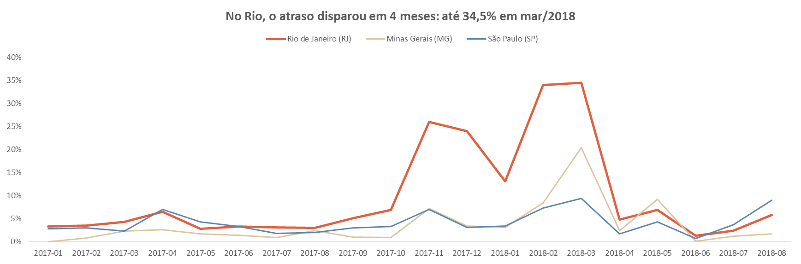
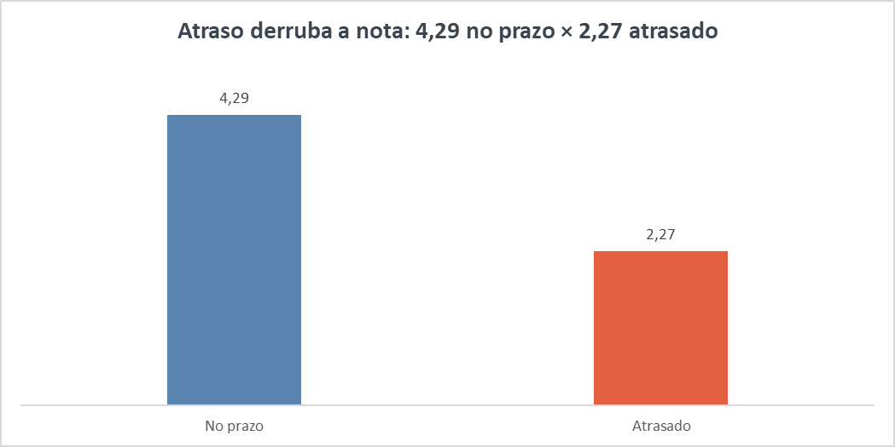

# Atrasos de entrega com SQL: no Rio, o problema estava em 4 meses e no transporte

Análise de cerca de 96 mil pedidos entregues da Olist, um marketplace brasileiro, para descobrir **onde** e **quando** os atrasos de entrega se concentram, e **em que etapa** eles acontecem.

**Principal descoberta:** 70% dos atrasos do Rio de Janeiro aconteceram em apenas 4 meses, e o gargalo era o transporte, não o vendedor.

📄 Página completa do projeto: [Notion](https://glittery-sorrel-fed.notion.site/Atrasos-de-entrega-com-SQL-40b2db5afb6e803ea6b5e3a3d8065ada)

---

## Resultados

**1. Atraso derruba a avaliação.** Pedidos no prazo têm nota média 4,29; pedidos atrasados, 2,27. 62% dos atrasados recebem nota 1 ou 2.

**2. O Rio concentra atrasos fora de proporção.** O RJ tem 12,8% dos pedidos, mas 22,9% de todos os atrasos do país.

**3. Mas não o ano todo.** Fora de 4 meses (nov/17, dez/17, fev/18 e mar/18), o atraso no Rio fica perto de 5%. Nesses meses, chega a 34,5%, e eles concentram 70% dos atrasos do estado.

**4. O volume de vendas não explica sozinho.** Em dez/17 o Rio teve menos pedidos que em jan/18 (746 contra 850) e atrasou quase o dobro (24% contra 13%). Os picos aparecem no resto do país, mas no Rio foram 2 a 3 vezes mais fortes.

**5. O gargalo era o transporte.** Nos pedidos atrasados do pico, o vendedor levou 4,4 dias para despachar; o transporte levou 34 dias, contra 8 nos pedidos no prazo.

## Recomendação

Em vez de reforçar a logística do Rio o ano inteiro, concentrar a atenção nos períodos de pico e na transportadora: ajustar o prazo prometido e acompanhar as entregas de perto nesses meses.

## Limitações

Os dados mostram quando e onde o Rio atrasou, mas não por quê. A causa dos picos precisaria de dados externos para ser confirmada. A base vai de 2016 a 2018: é um estudo de caso, não um retrato de hoje.

---

## Como reproduzir

1. Baixe a base [Brazilian E-Commerce Public Dataset by Olist](https://www.kaggle.com/datasets/olistbr/brazilian-ecommerce) no Kaggle.
2. Copie os 5 CSVs usados para a pasta liberada pelo MySQL (`SHOW VARIABLES LIKE 'secure_file_priv';`).
3. Rode `01_carga_olist.sql` para criar o banco e carregar as tabelas.
4. Rode `02_analise_atrasos.sql` para criar a visão base e as 8 consultas da análise.

## Arquivos

| Arquivo | O que faz |
|---|---|
| `01_carga_olist.sql` | Cria o banco `olist` e carrega 5 tabelas (pedidos, clientes, itens, vendedores, avaliações) |
| `02_analise_atrasos.sql` | Cria a visão `vw_entregas` e responde às 8 perguntas da análise |
| `grafico*.png` | Gráficos feitos no Excel a partir dos resultados das consultas |

## Ferramentas

MySQL 8 (JOIN, CTE, CASE, funções de janela, datas) · Excel

**Fonte dos dados:** Brazilian E-Commerce Public Dataset by Olist (Kaggle), dados públicos e anonimizados.
